# Quality Time Cafe & Resto

A website for a cafe and restaurant: customers can browse the menu, book a table, and place an order online, while staff manage everything from an admin dashboard.

> Academic team project by four students, D3 Information Technology, Institut Teknologi Del (2025). Who wrote what is visible in the commit history.

## Why this project

A cafe needs one place to show its menu, gallery, and contact details, and to take reservations and orders. Doing this by chat and paper is slow and easy to get wrong. This website puts the public pages, reservations, cart, orders, and content management in one system.

## Features

**Visitors and customers**
- Home, About, Menu, Testimonials, Gallery, and Contact pages
- Register and log in
- Browse the menu by category, add items to a cart, and place an order
- Book a table by choosing date, time, and number of guests
- Leave a message through the contact form

**Admin dashboard**
- Manage About content, menu items, testimonials, gallery, and contact messages
- Verify reservations and orders, and update their status
- Manage tables and page sections

## Tech stack

Laravel 10 (PHP), MySQL, Blade templates, Bootstrap, JavaScript, Vite.

The front end uses Bootstrap, AOS, and Bootstrap Icons. The admin area uses Material Dashboard assets. These third-party assets keep their own licenses.

## Run it locally

You need PHP, Composer, MySQL, and Node.js.

```bash
git clone https://github.com/Stevens2606/PA1-KELOMPOK14.git
cd PA1-KELOMPOK14
composer install
cp .env.example .env
php artisan key:generate
# create an empty MySQL database and set DB_* values in .env, then:
php artisan migrate --seed
php artisan serve
```

Open http://localhost:8000. The seeder creates a demo admin account (see `database/seeders/AdminUserSeeder.php`). Change it before using this anywhere outside your own computer.

## Screenshots

<table>
  <tr>
    <td align="center">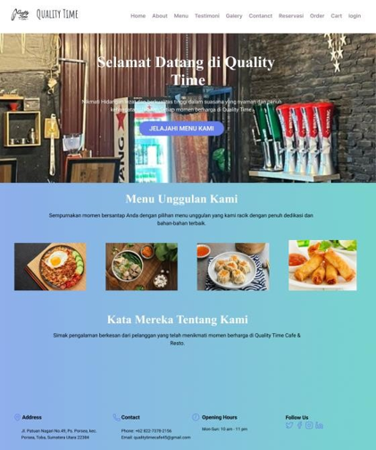<br>Home</td>
    <td align="center">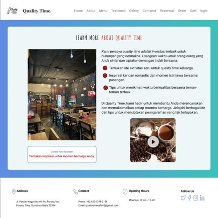<br>About</td>
  </tr>
  <tr>
    <td align="center">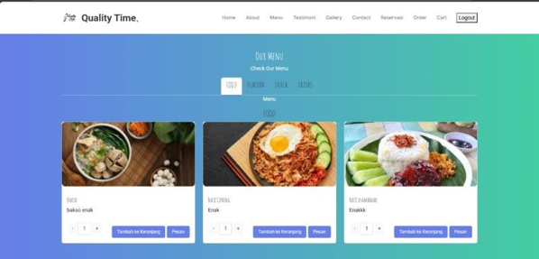<br>Menu with cart and order buttons</td>
    <td align="center">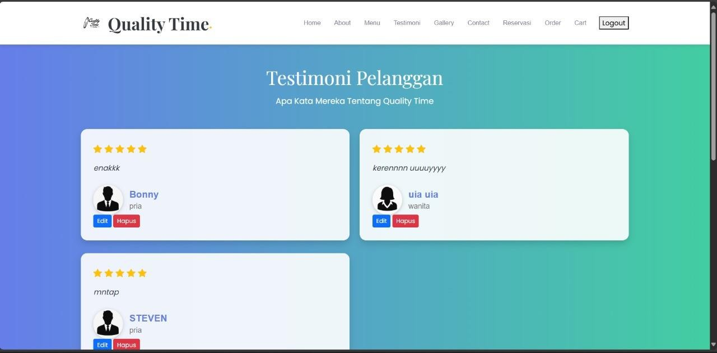<br>Testimonials</td>
  </tr>
  <tr>
    <td align="center">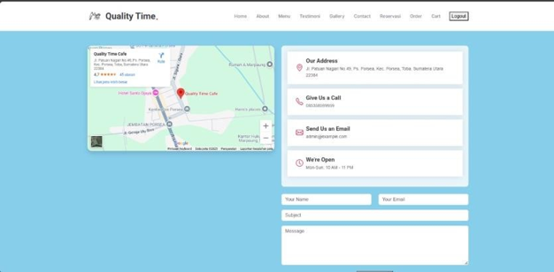<br>Contact and map</td>
    <td align="center">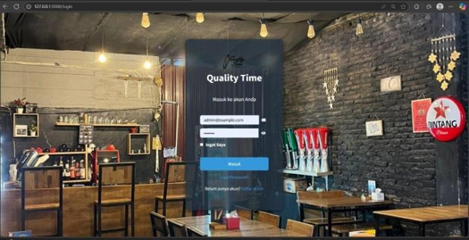<br>Login</td>
  </tr>
</table>

## Design

**Use case diagram** (guest, customer, admin)

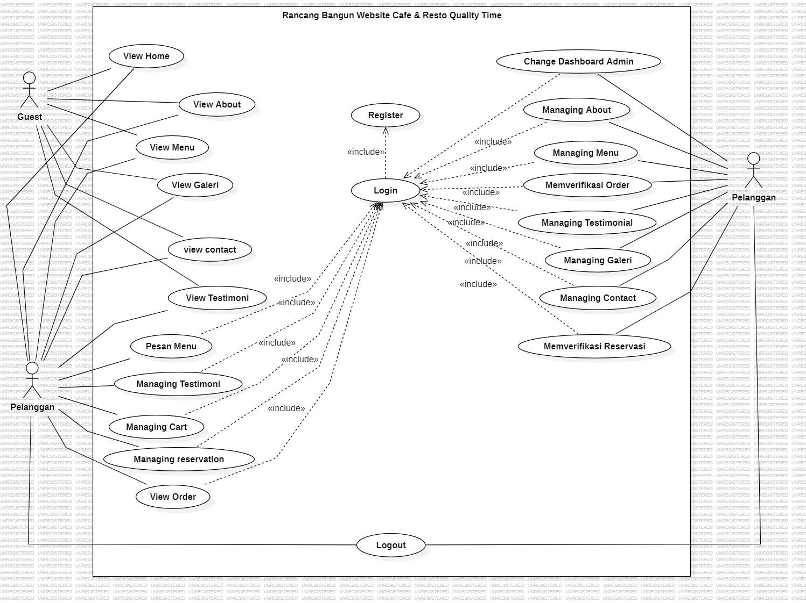

**Entity relationship diagram**

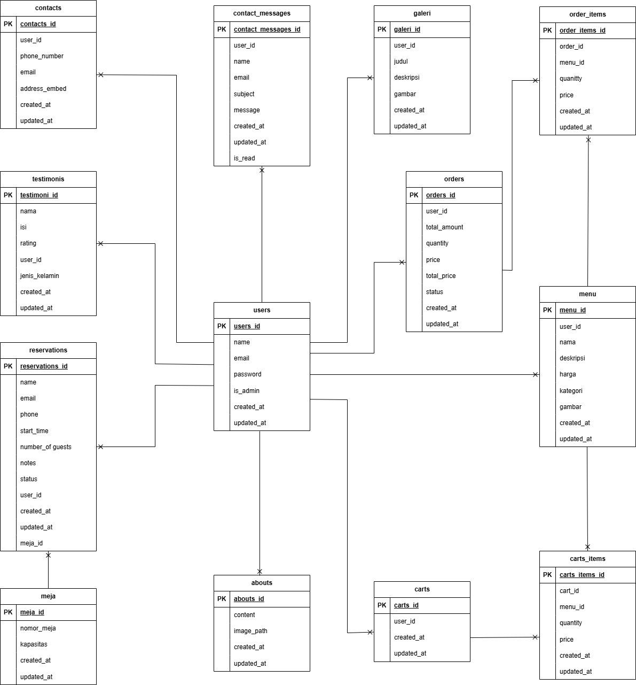

**Interface sketches** (wireframes made during design)

<table>
  <tr>
    <td align="center">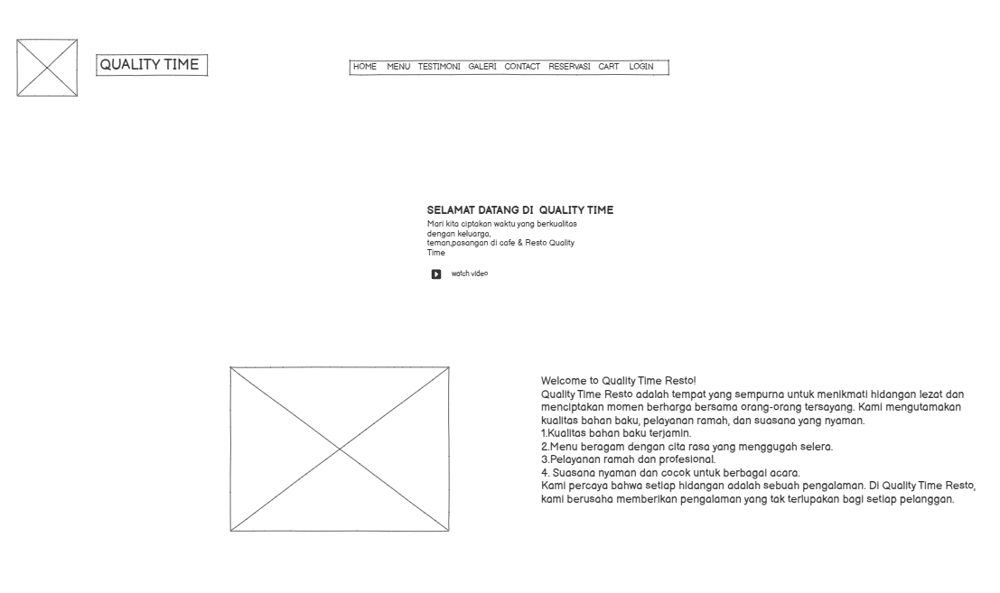<br>Home</td>
    <td align="center">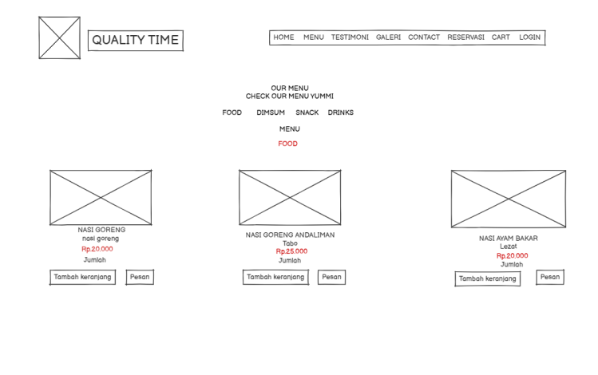<br>Menu</td>
  </tr>
  <tr>
    <td align="center">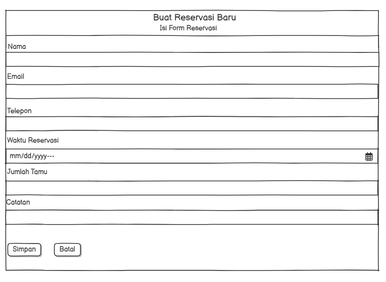<br>Reservation form</td>
    <td align="center">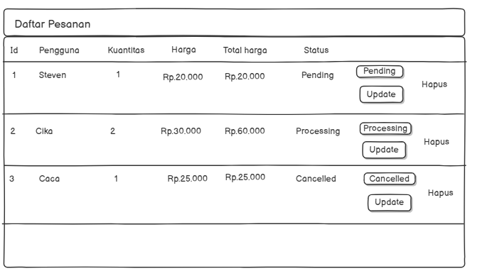<br>Order list (admin)</td>
  </tr>
</table>

## Team

Rancang Bangun Website Cafe & Resto Quality Time, Kelompok 14:

- Gresia Delia Silalahi
- Beta Kristien Manullang
- Steven Simanjuntak
- Februwati Silalahi

Commits in this repository are credited to the GitHub accounts of the authors who made them.

## Notes

This is a student project built for coursework.
